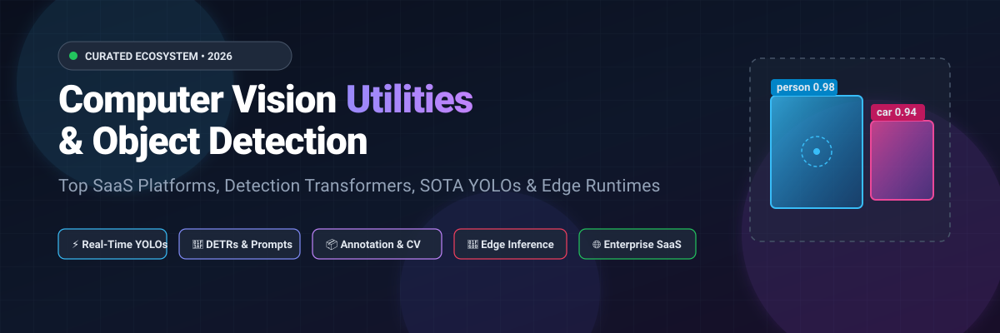

# 👁️ Awesome Computer Vision Utilities & Object Detection

<p align="center">
  
</p>

<p align="center">
  <a href="https://github.com/ishandutta2007/Awesome-Awesome-Awesome"></a><a href="https://discord.gg/jc4xtF58Ve"></a>
  <a href="https://github.com/ishandutta2007/Awesome-Awesome-Awesome"></a>
  <a href="https://github.com/ishandutta2007/Awesome-Computer-Vision-Utilities-Object-Detection/stargazers"></a>
  <a href="https://github.com/ishandutta2007/Awesome-Computer-Vision-Utilities-Object-Detection/network/members"></a>
  <a href="https://github.com/ishandutta2007/Awesome-Computer-Vision-Utilities-Object-Detection/issues"></a>
  <a href="https://github.com/ishandutta2007/Awesome-Computer-Vision-Utilities-Object-Detection/blob/main/LICENSE"></a>
  <a href="https://github.com/ishandutta2007"></a>
</p>

---

## 📌 Top Computer Vision Utilities & Object Detection Ecosystem

> **Curated List of SaaS / Hosted Platforms & High-Performance Open-Source GitHub Projects**  
> *Focused on Real-Time Object Detectors, Detection Transformers (DETR), Model-Agnostic CV Post-Processing Utilities, Slicing & Small Object Inference, Bounding-Box/Polygon Annotators, Zone Analytics, and Edge Deployment Runtimes.*

Last updated: **November 2026** 🚀

This repository curates notable **SaaS/hosted computer vision platforms** and **open-source repositories** powering modern visual AI. These solutions detect, localize, segment, classify, annotate, visualize, track, count, and evaluate objects across multi-spectral images and high-fps video streams using state-of-the-art vision backbones, real-time detectors (YOLO, RT-DETR, RF-DETR, Grounding DINO), foundational segmenters (SAM, SAM 2), active learning pipelines, and edge-optimized runtimes (TensorRT, OpenVINO).

---

## 📑 Table of Contents

- [📊 Sector Overview & Market Dynamics](#-sector-overview--market-dynamics)
- [☁️ SaaS / Hosted Platforms](#️-saas--hosted-platforms)
- [💻 Open-Source GitHub Projects](#-open-source-github-projects)
- [🛠️ Recommended System Architecture](#️-recommended-system-architecture)
- [🤝 How to Contribute](#-how-to-contribute)
- [💖 Support & Share](#-support--share)
- [📈 Star History](#-star-history)
- [⚖️ Disclaimer](#️-disclaimer)

---

## 📊 Sector Overview & Market Dynamics

The global computer vision market is estimated between **$23 Billion and $32 Billion in 2026**, on track to exceed **$65 Billion to $70+ Billion by 2030** with an annual growth rate (CAGR) of ~18–21%. 

Structurally, the sector exhibits a **moderately fragmented yet two-tiered dynamic**: hyperscale infrastructure providers and foundational hardware giants (NVIDIA, Intel, Microsoft, Meta) dominate base acceleration runtimes and foundation models, while a highly competitive, fragmented ecosystem of agile SaaS startups and specialized open-source tools actively contest data labeling, model-agnostic post-processing, and vertical-specific edge vision deployments.

---

## ☁️ SaaS / Hosted Platforms

Below is a comparison of premier hosted Computer Vision and annotation platforms, sorted by **Company Valuation / Scale (Descending)**:

| 🏢 Platform | 💰 Scale / Valuation | 🏷️ Starting Pricing Tier | 🎁 Free Tier Limits | 🔍 Core Focus & Capabilities |
| :--- | :--- | :--- | :--- | :--- |
| **[Scale AI](https://scale.com)** | **$29.0B Valuation** (~$1.5B–$2B ARR) | **$0.05 / unit** (Rapid Self-Labeling overage; custom managed task pricing) | **200 free labeling units/month** (Self-labeling: 1 annotation = 1 unit, 1 attribute = 0.5 units) | Enterprise AI data engine providing 2D/3D sensor-fusion bounding boxes, automated RLHF, and edge-case dataset debugging. |
| **[Labelbox](https://labelbox.com)** | **$1.25B Valuation** (~$50M ARR) | **Custom annual/monthly quote** (Starter/Team tiers negotiated per seat/volume) | **500 Labelbox Units (LBUs)/month** (up to 30 users, 50 projects, max 10M rows) | Collaborative data-centric AI platform with model-assisted object detection, active learning workflows, and QA catalog filters. |
| **[Clarifai](https://clarifai.com)** | **$775M Valuation** ($101M Raised) | **$30 / month** (Essential Tier; Professional starts at $300/mo) | **1,000 operations & 1,000 inputs/month** (Free Community plan for predictions, concepts, and searches) | Full-stack cloud vision platform featuring pre-trained detection workflows, visual vector search, and edge/cloud APIs. |
| **[Encord](https://encord.com)** | **$550M Valuation** ($60M Series C) | **Custom quote** (Starter Tier designed for early-stage teams & pilots) | **14-day guided proof-of-concept trial** (available upon request, full access to multimodal toolkit) | AI-assisted data curation and multimodal annotation platform tailored for physical AI, robotics, and medical object detection. |
| **[Landing AI](https://landing.ai)** | **$300M–$500M Est. Valuation** ($57M Raised) | **$0.01 / credit** (Pay-as-you-go or custom Visionary enterprise plans) | **1,000 free credits/month** (LandingLens Explore plan: up to 10k images/project, 3 seats, non-commercial models) | Andrew Ng’s industrial vision platform optimized for defect localization, few-shot small-dataset training, and LandingEdge deployments. |
| **[SuperAnnotate](https://superannotate.com)** | **$100M–$250M Valuation** ($50M Series B) | **Custom quote** (Starter Tier with ~1K compute orchestration hours) | **Free-forever plan up to 5 users & 500 items** (core multimodal image/video editors and cloud integrations) | End-to-end annotation suite featuring AI copilot labeling, precision polygon segmentation, and multi-class hierarchy management. |
| **[Dataloop](https://dataloop.ai)** | **$120M Acquisition Valuation** (by Dell Technologies) | **Custom enterprise quote** (based on data pipeline volume and MLOps compute nodes) | **14-day guided sandbox trial** (scheduled enterprise evaluation with sample computer vision workflows) | Cloud data engine uniting high-throughput video object detection, active learning loops, and automated pipeline functions. |
| **[V7 Labs](https://v7labs.com)** | **$100M+ Valuation** ($43M Raised) | **$499 / month** (Starter/Team bundle; AWS Marketplace starter ~9k/yr) | **14-day free trial** (unlimited access to Darwin auto-labeling, models, and bounding box/polygon tools) | Data engine offering foundation-model auto-labeling (Darwin), real-time video tracking, and automated dataset versioning. |
| **[Roboflow](https://roboflow.com)** | **$40M+ Est. Valuation** ($22M Raised) | **$39 / month** (Credit packs starting tier; flexible consumption billing) | **10 free credits/month** (private workspaces, model weight exports, unlimited seats, free self-hosted inference) | End-to-end computer vision ecosystem offering dataset management, automated augmentation, hosted training, and Universe models. |
| **[Chooch](https://chooch.com)** | **$25M+ Funding / Growth** ($25.8M Raised) | **Custom enterprise tier** (usage-based per stream/API camera feed) | **Free developer trial account** (testing access to vision studio APIs and pre-trained object recognition models) | Edge-to-cloud AI vision platform delivering sub-second video stream analytics, automated alerts, and industrial visual telemetry. |

---

## 💻 Open-Source GitHub Projects

Explore the top open-source tools, model architectures, and post-processing libraries, **sorted by GitHub Stars (Descending)**. Each repository features a real-time star badge linking directly to its stargazers:

1. **[OpenCV](https://github.com/opencv/opencv)** [](https://github.com/opencv/opencv/stargazers)  
   Foundational open-source C++/Python computer vision and image processing library offering thousands of optimized algorithms for real-time video I/O, matrix transformations, geometric warping, and deep learning runtime inference.

2. **[Ultralytics YOLO](https://github.com/ultralytics/ultralytics)** [](https://github.com/ultralytics/ultralytics/stargazers)  
   Industry-standard real-time object detection framework supporting YOLOv8, YOLO11, and modern YOLO architectures for real-time bounding boxes, oriented bounding boxes (OBB), instance segmentation, and hardware export to ONNX, TensorRT, and CoreML.

3. **[YOLOv5 (`ultralytics/yolov5`)](https://github.com/ultralytics/yolov5)** [](https://github.com/ultralytics/yolov5/stargazers)  
   Ultralytics' landmark PyTorch implementation of YOLOv5, renowned for exceptional deployment simplicity, mobile quantization, and battle-tested production stability.

4. **[Segment Anything (`facebookresearch/segment-anything`)](https://github.com/facebookresearch/segment-anything)** [](https://github.com/facebookresearch/segment-anything/stargazers)  
   Meta AI's foundation model for zero-shot promptable image segmentation (SAM), revolutionizing automated bounding-box-to-polygon conversion and interactive auto-labeling.

5. **[roboflow/supervision](https://github.com/roboflow/supervision)** [](https://github.com/roboflow/supervision/stargazers)  
   The definitive open-source Python library for computer vision post-processing—featuring unified `Detections` data structures, bounding-box/mask annotators, polygon and line zone counting, heatmaps, ByteTrack tracking, and dataset format conversions.

6. **[Detectron2 (`facebookresearch/detectron2`)](https://github.com/facebookresearch/detectron2)** [](https://github.com/facebookresearch/detectron2/stargazers)  
   Meta AI's modular PyTorch computer vision research platform implementing Mask R-CNN, Faster R-CNN, RetinaNet, DensePose, and Panoptic Feature Pyramid Networks.

7. **[MMDetection (`open-mmlab/mmdetection`)](https://github.com/open-mmlab/mmdetection)** [](https://github.com/open-mmlab/mmdetection/stargazers)  
   OpenMMLab's comprehensive PyTorch object detection benchmark toolbox supporting dozens of leading backbones, multi-scale feature pyramids, mixed-precision training, and custom evaluation metrics.

8. **[Label Studio (`HumanSignal/label-studio`)](https://github.com/HumanSignal/label-studio)** [](https://github.com/HumanSignal/label-studio/stargazers)  
   Extensible multi-modal data labeling tool supporting bounding-box object detection, semantic polygon tagging, OCR annotations, and custom ML backend pre-labeling hooks.

9. **[Darknet (`pjreddie/darknet`)](https://github.com/pjreddie/darknet)** [](https://github.com/pjreddie/darknet/stargazers)  
   The original open-source neural network framework written in C and CUDA by Joseph Redmon, which pioneered real-time object detection with YOLO, YOLOv2, and YOLOv3.

10. **[SAM 2 (`facebookresearch/sam-2`)](https://github.com/facebookresearch/sam-2)** [](https://github.com/facebookresearch/sam-2/stargazers)  
    Meta AI's foundation model for promptable visual segmentation across both static images and streaming real-time video with streaming memory architecture.

11. **[CVAT (`cvat-ai/cvat`)](https://github.com/cvat-ai/cvat)** [](https://github.com/cvat-ai/cvat/stargazers)  
    Full-featured web-based computer vision annotation tool for images and video streams, featuring automated AI tracker interpolation, SAM integration, multi-user project management, and COCO/YOLO exports.

12. **[Albumentations (`albumentations-team/albumentations`)](https://github.com/albumentations-team/albumentations)** [](https://github.com/albumentations-team/albumentations/stargazers)  
    Blazing fast, production-grade image augmentation library with synchronized coordinate transformations for bounding boxes, keypoints, and segmentation masks.

13. **[PaddleDetection (`PaddlePaddle/PaddleDetection`)](https://github.com/PaddlePaddle/PaddleDetection)** [](https://github.com/PaddlePaddle/PaddleDetection/stargazers)  
    Baidu’s end-to-end object detection development kit providing high-throughput models (PP-YOLOE, PicoDet), multi-object tracking, and edge acceleration tools.

14. **[YOLOv7 (`WongKinYiu/yolov7`)](https://github.com/WongKinYiu/yolov7)** [](https://github.com/WongKinYiu/yolov7/stargazers)  
    Influential real-time detector introducing extended efficient layer aggregation networks (E-ELAN) and compound scaling methods that set previous SOTA speed/accuracy benchmarks.

15. **[NVIDIA TensorRT (`NVIDIA/TensorRT`)](https://github.com/NVIDIA/TensorRT)** [](https://github.com/NVIDIA/TensorRT/stargazers)  
    NVIDIA's premier C++/Python deep learning inference optimizer and runtime for high-throughput, low-latency INT8/FP16 object detection on GeForce, RTX, and Jetson hardware.

16. **[Kornia (`kornia/kornia`)](https://github.com/kornia/kornia)** [](https://github.com/kornia/kornia/stargazers)  
    Differentiable computer vision library for PyTorch enabling GPU-accelerated geometric transformations, edge filtering, and epipolar geometry directly within backpropagation loops.

17. **[OpenVINO Toolkit (`openvinotoolkit/openvino`)](https://github.com/openvinotoolkit/openvino)** [](https://github.com/openvinotoolkit/openvino/stargazers)  
    Intel's open-source toolkit for optimizing and deploying deep learning computer vision models across CPUs, GPUs, and VPUs with model compression and INT8 quantization.

18. **[YOLOv10 (`THU-MIG/yolov10`)](https://github.com/THU-MIG/yolov10)** [](https://github.com/THU-MIG/yolov10/stargazers)  
    Tsinghua University's real-time end-to-end object detector eliminating Non-Maximum Suppression (NMS) latency via dual label assignments.

19. **[FiftyOne (`voxel51/fiftyone`)](https://github.com/voxel51/fiftyone)** [](https://github.com/voxel51/fiftyone/stargazers)  
    Open-source dataset visualization, curation, and model evaluation tool for diagnosing detection false positives, finding labeling errors, and computing COCO mAP metrics.

20. **[X-AnyLabeling (`CVHub520/X-AnyLabeling`)](https://github.com/CVHub520/X-AnyLabeling)** [](https://github.com/CVHub520/X-AnyLabeling/stargazers)  
    Cross-platform desktop auto-annotation utility integrating YOLO, RT-DETR, Grounding DINO, and SAM 2 for effortless local offline dataset preparation.

21. **[Grounding DINO (`IDEA-Research/GroundingDINO`)](https://github.com/IDEA-Research/GroundingDINO)** [](https://github.com/IDEA-Research/GroundingDINO/stargazers)  
    Groundbreaking open-vocabulary open-set object detector capable of locating arbitrary objects from natural-language text prompts without re-training.

22. **[RF-DETR (`roboflow/rf-detr`)](https://github.com/roboflow/rf-detr)** [](https://github.com/roboflow/rf-detr/stargazers)  
    State-of-the-art real-time detection transformer (Apache 2.0) engineered by Roboflow for blazing-fast fine-tuning, superior small-object recall, and edge inference.

23. **[YOLOv9 (`WongKinYiu/yolov9`)](https://github.com/WongKinYiu/yolov9)** [](https://github.com/WongKinYiu/yolov9/stargazers)  
    Pioneered Programmable Gradient Information (PGI) and Generalized Efficient Layer Aggregation Networks (GELAN) to combat information loss in deep detector backbones.

24. **[scikit-image (`scikit-image/scikit-image`)](https://github.com/scikit-image/scikit-image)** [](https://github.com/scikit-image/scikit-image/stargazers)  
    Core collection of classic image processing algorithms in Python for color spaces, morphology, thresholding, filtering, and connected components.

25. **[RT-DETR (`lyuwenyu/RT-DETR`)](https://github.com/lyuwenyu/RT-DETR)** [](https://github.com/lyuwenyu/RT-DETR/stargazers)  
    The first real-time end-to-end Detection Transformer outperforming comparable YOLOs while entirely removing NMS post-processing overhead.

26. **[SAHI — Slicing Aided Hyper Inference (`obss/sahi`)](https://github.com/obss/sahi)** [](https://github.com/obss/sahi/stargazers)  
    Lightweight vision utility executing sliced/tiled window inference on ultra-high-resolution aerial, satellite, and 4K images to accurately detect tiny objects.

---

## 🛠️ Recommended System Architecture

For teams designing modern computer vision workflows, here is the battle-tested combination:

```
[ Dataset Curation & Auto-Labeling ]
       CVAT / X-AnyLabeling + SAM 2 / Grounding DINO
                           │
                           ▼
[ Preprocessing & Synchronized Augmentation ]
       Albumentations / Kornia
                           │
                           ▼
[ Model Training & Architecture Selection ]
       Ultralytics YOLO / RF-DETR / RT-DETR
                           │
                           ▼
[ Error Analysis & Dataset Auditing ]
       FiftyOne (mAP, Confusion Matrix, FP/FN inspection)
                           │
                           ▼
[ Edge Acceleration & High-Throughput Inference ]
       NVIDIA TensorRT / OpenVINO / ONNX
                           │
                           ▼
[ Post-Processing, Small-Object Slicing & Analytics ]
       SAHI (Tiled Inference) + roboflow/supervision (Zones, Tracing & Triggers)
```

---

## 🤝 How to Contribute

Contributions are welcome! Follow these steps to submit additions or updates:

1. 🍴 **Fork the repository**.
2. 🌿 **Create a descriptive feature branch** (`git checkout -b feature/add-cv-utility`).
3. 📝 **Add your entries** adhering to existing Markdown formatting, tabular structures, and badge conventions.
4. 🚀 **Submit a Pull Request** with a brief summary explaining the project's utility and license.

---

## 💖 Support & Share

A huge **thank you** to all contributors, developers, and researchers advancing the frontiers of computer vision, real-time object detection, and visual AI! 🌟

If you find this curated collection useful for your research, team, or production pipelines, please consider supporting the project:

- ⭐ **Star this repository** on GitHub to help engineers and researchers discover it!
- 🍴 **Fork & Share** it with your network, team, and communities on X/Twitter, LinkedIn, and Reddit.
- ☕ **Buy me a coffee / Sponsor** my open-source work via the [GitHub Sponsor Dashboard](https://github.com/sponsors/ishandutta2007) to help maintain awesome developer tools!

[](https://github.com/sponsors/ishandutta2007)

---

## 📈 Star History

[](https://www.star-history.com/#ishandutta2007/Awesome-Computer-Vision-Utilities-Object-Detection&type=date&legend=top-left)

---

## ⚖️ Disclaimer

- This curated list is maintained for educational, architectural, and developer reference purposes; listings do not represent commercial endorsement.
- Verify licenses before production deployment (e.g., Apache 2.0 for `RF-DETR`, `RT-DETR`, and `supervision` vs. AGPL-3.0 for `Ultralytics`).
- Live video analytics deployments must strictly comply with local privacy regulations (such as GDPR, CCPA) and responsible AI governance.
